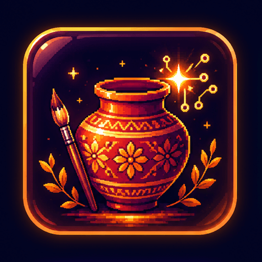
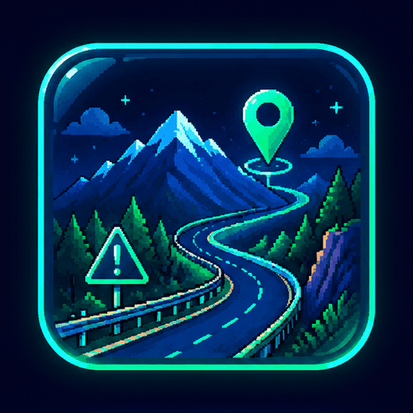
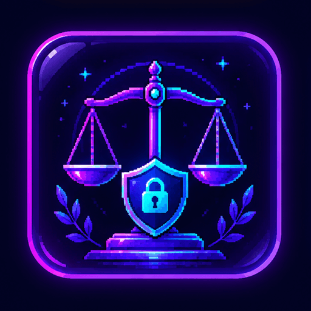
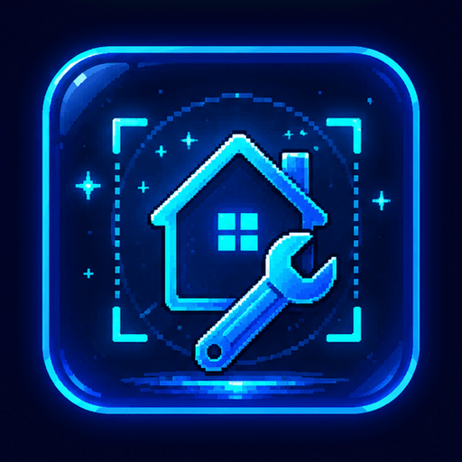
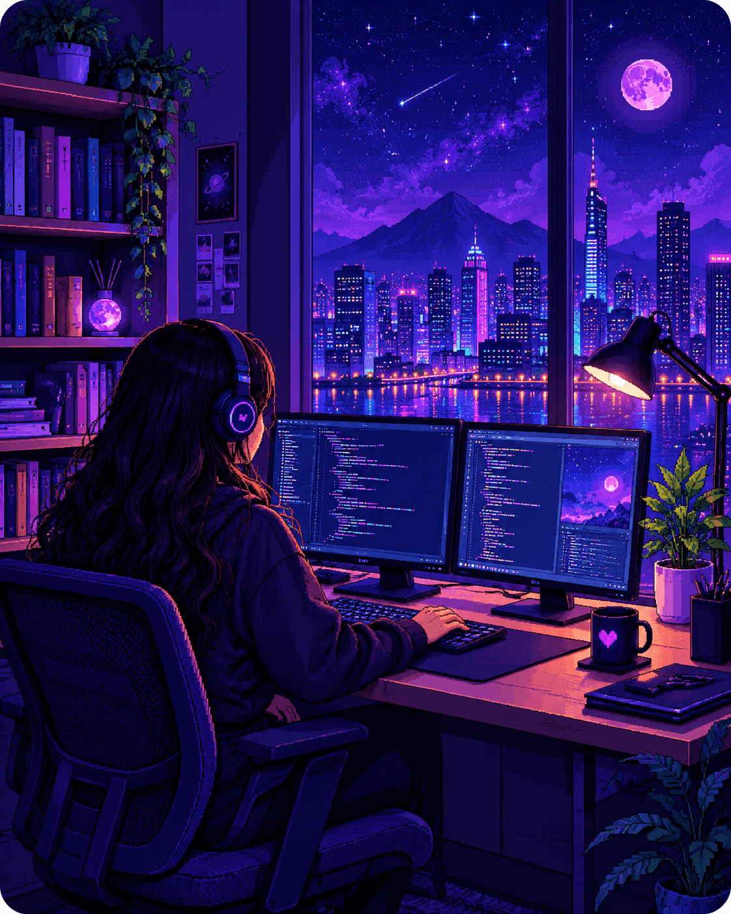

  

# Vidhi Garg

**@Vidhigarg19** · BTech CSE · 3rd Year · 📍 Dehradun, India

*Turning ideas into real solutions through code, data and creativity.*

 

  

 

## 📊 GitHub Stats

 

 

 

## 🚀 Featured Projects

<table>
  <tr>
    <td align="center" width="50%">
       
      <a href="https://github.com/Vidhigarg19/Kalakriti"><b>Kalakriti+</b></a> 
      AI-driven market-linkage platform for artisans  
      <code>React</code> <code>FastAPI</code> <code>PostgreSQL</code>
    </td>
    <td align="center" width="50%">
       
      <a href="https://github.com/Vidhigarg19/REPO_RAAHPRAHARI"><b>RaahPrahari</b></a> 
      Hill-road safety and community reports  
      <code>React</code> <code>FastAPI</code> <code>PostgreSQL</code>
    </td>
  </tr>
  <tr>
    <td align="center">
       
      <a href="https://github.com/sskksingh2005/Sakshya"><b>Sakshya</b></a> 
      Silent reporting with SHA-256 evidence integrity  
      <code>React</code> <code>Node.js</code> <code>PostgreSQL</code>
    </td>
    <td align="center">
       
      <a href="https://github.com/Vidhigarg19/fixaura"><b>FixAura</b></a> 
      AI home-repair assistant with AR guidance 
      <code>React</code> <code>OpenAI</code> <code>Tailwind</code>
    </td>
  </tr>
</table>

 

## 🛠 Tech Stack

  

## 🎯 Skills

  

## 📈 Contribution Graph

 

## 👩‍💻 About Me

I'm **Vidhi**, a BTech CSE student from Dehradun who loves turning ideas into products that genuinely help people. I learn best by building, so most of what I know comes from hackathons, side projects and shipping things end to end, from the idea and the database to the UI.

My work sits at the intersection of **full-stack development, data science and machine learning**. So far that has meant an AI-powered marketplace for rural artisans, a hill-road safety platform built on community reports, a silent reporting system that protects evidence with SHA-256 integrity, and an AI home-repair assistant with AR guidance.

 

🚀 **Building:** AI-driven products with React, FastAPI, Node.js and PostgreSQL 
📚 **Learning:** DSA, system design and cloud on AWS 
🏆 **Hackathons:** Smart India Hackathon 2026 · Hack the Future 3.0 
🤝 **Open to:** collaborations, hackathon teams and open-source contributions 

 

`DSA` · `Web Dev` · `Data Science` · `Hackathons` · `Open Source`

**🔭 Currently exploring:** System Design · ML · AWS

 

  

*"Small steps every day lead to big results ✨"*

